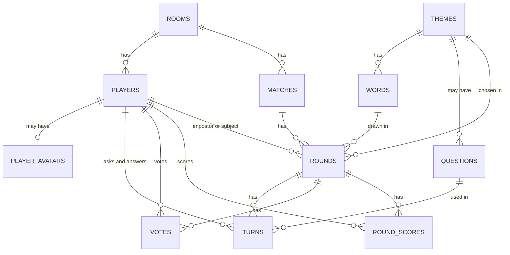

# Database

PostgreSQL 17 or newer (`storage.Open` checks the server version). The schema is created by the
SQL migrations in `internal/storage/migrations`.

## Tables

| Table | Purpose |
|---|---|
| `themes` | Catalog of themes. `kind` is `words` or `players`. |
| `words` | Words of the `words` themes. |
| `questions` | Questions read aloud. `kind` is required, `theme_id` is optional (null means generic for that kind). |
| `rooms` | A room: `code`, `expires_at` (creation + 24h) and `empty_since`. |
| `players` | Players of a room: `is_host`, `token_hash` (SHA-256), `joined_at` (orders the host succession), `connected_at` (the first time the player opened the room's WebSocket, null before; migration `add_player_connected_at`), `left_at` (when they left or were removed; null while in the room; migration `add_player_left_at`: players are marked, never deleted, since deleting cascades to their rounds). `last_seen_at` is set on joining and not updated yet: presence lives in the room actor's memory. |
| `player_avatars` | A player's optional photo (`image`, a JPEG re-encoded by the server, 1 byte to 500 KiB) and `updated_at`, its version in the avatar URL. Apart from `players` so the usual queries never read the image; `loadPlayers` only reads `updated_at`. |
| `matches` | A match in a room: status, `total_rounds` (3, 5, 8, 10, 12), `turn_seconds`. "Play again" adds a match. |
| `rounds` | A round: phase, theme, secret (`word_id` or `subject_player_id`), impostor, `current_turn`, `phase_deadline_at`, `impostor_found`, `guess_options` (JSON array of option ids), the guess (`guess_word_id` or `guess_player_id`, `guess_correct`). |
| `turns` | The ring of turns of a round, created up front: asker, answerer, question, deadline, `ended_by`. |
| `votes` | One per player per round (primary key); a new vote replaces it while the voting is open. `target_id` null is an abstention, recorded when the voting closes. |
| `round_scores` | Points per round and reason. The scoreboard is their sum. |

## Invariants enforced by the database

- `words` only belong to `words` themes (composite foreign key on `(theme_id, kind)`).
- A question's `kind` matches its theme's kind (composite foreign key; skipped for generic
  questions, whose `theme_id` is null).
- A question text is unique per `(kind, theme_id)`, including generic ones (`NULLS NOT DISTINCT`).
- At most one host per room (partial unique index), unique player names among the players still
  in the room (partial unique index `WHERE left_at IS NULL`), and nobody who left is the host.
- A round never has both a word and a player as secret, and its word belongs to its theme.
- A question never repeats within a round, and a turn's asker differs from its answerer.
- Nobody votes for themselves.
- `matches.total_rounds`, phases, statuses and score reasons are limited by `CHECK` constraints.
- A photo is 1 byte to 500 KiB (`player_avatars_image_size_check`, raised by the migration
  `raise_player_avatar_limit`), at most one per player
  (primary key), and is deleted with its player.
- `rounds.phase` is one of `theme_selection`, `reveal`, `questions`, `discussion`, `voting`,
  `guess`, `result` (`guess` added by the migration `add_guess_phase`).
- Deleting a room cascades to players (and their photos), matches, rounds, turns, votes and scores (`ON DELETE
  CASCADE` is set on all tables hanging from `rooms`, including foreign keys referencing
  `players` in `rounds`, `turns`, `votes`, and `round_scores`; migration `cascade_player_fkeys`).
  So deleting a single player also deletes the rounds in which they were the impostor or the
  subject.

## Conventions

- Primary keys: `uuid` generated by `gen_random_uuid()` for game state, `bigint` identity for the
  catalog.
- Timestamps are `timestamptz`.
- `text` plus `CHECK` instead of PostgreSQL enums, so adding a value is a simple migration.
- Positions and turn indexes are zero-based.

## Models and queries

Every table has a bun model in `internal/storage/models.go` (`Theme`, `Word`, `Question`,
`Room`, `Player`, `Match`, `Round`, `Turn`, `Vote`, `RoundScore`). Relations are declared on the
models (`Round.Word`, `Round.Subject`, `Turn.Question`) and loaded with `Relation`. Every query
uses the bun query builder with these models; the only SQL text is in the migrations and in the
test helper that resets the schema (`storagetest`).

- Every model lists every column of its table. A migration that adds a column adds the field
  to the model in the same change, or reading whole rows (`Returning("*")`) fails.
- Columns whose default differs from the Go zero value (`id`, `created_at`, `status`, `phase`,
  `turn_seconds`, `words.kind`...) are tagged `nullzero`: a zero value is written as `DEFAULT`.
  Defaults equal to the zero value (`is_host`, `theme_drawn`, `current_turn`) need no tag.
- Nullable columns are pointers (`*time.Time`, `*string`, `*int64`).
- Inserts that may hit a unique constraint use `On("CONFLICT ... DO NOTHING")` with
  `Returning("id")` and `Scan`, so a skipped row surfaces as `sql.ErrNoRows`.
- Guarded updates (`Where("phase = ?", ...)`) check that exactly one row changed.

## Joining a room

`storage.Rooms.AddPlayer` runs in one transaction:

1. Selects the room by code and `expires_at > now` with `For("UPDATE")`: an expired room that
   the janitor has not deleted yet is treated as missing. The row lock serializes concurrent
   joins to the same room, which keeps the player count check correct.
2. Reads the latest match (highest `number`) and its latest round. Joining is allowed when the
   match is in `lobby`, or `in_progress` with its latest round in `result`. Otherwise it fails
   with `match_in_progress` (a round is running, or the match has no round yet) or
   `match_finished` (`finished`, `ended_early`).
3. Counts the players holding a seat against the limit (20): those with `connected_at` set, or who
   joined less than `game.SeatHoldTime` (2 minutes) ago. Joins that never open the room stop
   counting, so they cannot keep it full.
4. Inserts the player with `ON CONFLICT (room_id, name) DO NOTHING`: no row back means the name
   is taken, and the service retries with a numbered name.

Creating a room writes `rooms` (with `empty_since` = creation time, since nobody is connected
yet), match number 1 in `lobby` and the host player in one transaction.

## Live rooms

The room actors (`storage/live.go`, `room.LiveStore`) authenticate a connection by looking up
the room by code (not expired) and then the player of that room with the SHA-256 of the token
(`token_hash`); the token itself is never stored. They write:

- `rooms.empty_since`: cleared while someone is connected (each connection retries a failed
  clear), set when the last one leaves or when an idle actor stops with it still clear. The update
  reports a missing row (`room.ErrRoomNotFound`), so an actor learns that the janitor deleted its
  room. At startup `Rooms.MarkAllEmpty` sets it on every room where it is null: no WebSocket
  survives a restart.
- `players.connected_at`: set on a player's first connection (`MarkConnected`; later calls change
  nothing).
- `players.is_host`: moved in one transaction when the host transfers (clear the old host,
  then set the new one, so the one-host partial unique index always holds).
- `StartMatch`: locks the room row (`FOR UPDATE`, like a join), sets the match `in_progress`
  with `started_at`, creates round 1 in `theme_selection` and re-reads the players, all in one
  transaction. A join and a start never interleave.

Round flow (`storage/live.go`):

- `LoadRoundCandidates`: the theme's words never used by any round of any match of the room
  (`NOT EXISTS` over `rounds.word_id`), and the questions of the theme's kind that belong to the
  theme or are generic (`theme_id IS NULL`).
- `BeginRound`: sets the theme, the secret (`word_id` or `subject_player_id`), the impostor and
  `phase = 'reveal'`, guarded by `phase = 'theme_selection'`, and inserts the whole turn ring
  (`turns_round_question_key` keeps questions unique in the round). The turn ids are read back
  ordered by position instead of relying on the order of `RETURNING`.
- `StartQuestions`, `ExtendTurn`, `AdvanceTurn`, `ExtendDiscussion`, `StartVoting`: each guarded
  by the phase (or `ended_at IS NULL`) it expects, so an update that finds the round elsewhere
  changes nothing and fails. `AdvanceTurn` records `ended_at` and `ended_by` (`answerer`, `host`,
  `timeout`), then moves `current_turn` and starts the next turn, or sets `phase = 'discussion'`
  with `phase_deadline_at`.

Voting, guess and result (`storage/live.go`):

- `StartVoting` sets `phase = 'voting'` and `phase_deadline_at` (5 minutes).
- `CastVote` upserts the vote on the primary key `(round_id, voter_id)` (a player can change it
  while the voting is open), and the `CHECK` refuses self-votes.
- `StartGuess` records the abstentions (`target_id` null), sets `impostor_found`, the
  `guess_options` and `phase = 'guess'` with a 60-second `phase_deadline_at`. `LoadGuessWords`
  provides the candidate words: the words of the theme no other round of the room used (the same
  set the secret was drawn from), so no option can be ruled out from an earlier result.
- `FinishRound` records the abstentions (when coming straight from the voting), the outcome and
  the guess, inserts the `round_scores` and sets `phase = 'result'`, guarded by
  `phase IN ('voting', 'guess')`.
- `NextRound` inserts the next round in `theme_selection`; `EndMatch` sets the match `finished`
  or `ended_early` with `ended_at`; `PlayAgain` inserts match number + 1 in `lobby`.

`LoadRoom` reads the room, its latest match (with `turn_seconds`) and round (theme, secret text,
impostor, turn ring with question texts and deadlines, `current_turn`, `phase_deadline_at`, the
votes, the guess options with their labels, the guess and the points of the round), the
impostors and subjects of the earlier rounds of the match (the rotation history), the players
with their scores in that match (sum of `round_scores`) and the theme catalog with kinds, in one
read-only repeatable-read transaction.

## Cleanup

`internal/janitor` calls `Rooms.DeleteExpired` every minute: rooms with `expires_at` in the past
and rooms empty for more than `EMPTY_ROOM_TTL` (1 hour) are deleted, in batches of 500 until a
batch comes back short, within 30 seconds per run (a hung database does not stall it). Because all child tables
and cross-table player references cascade on delete, removing expired rooms deletes all associated
players, matches, rounds, turns, votes, and scores in a single query without foreign key conflicts.
