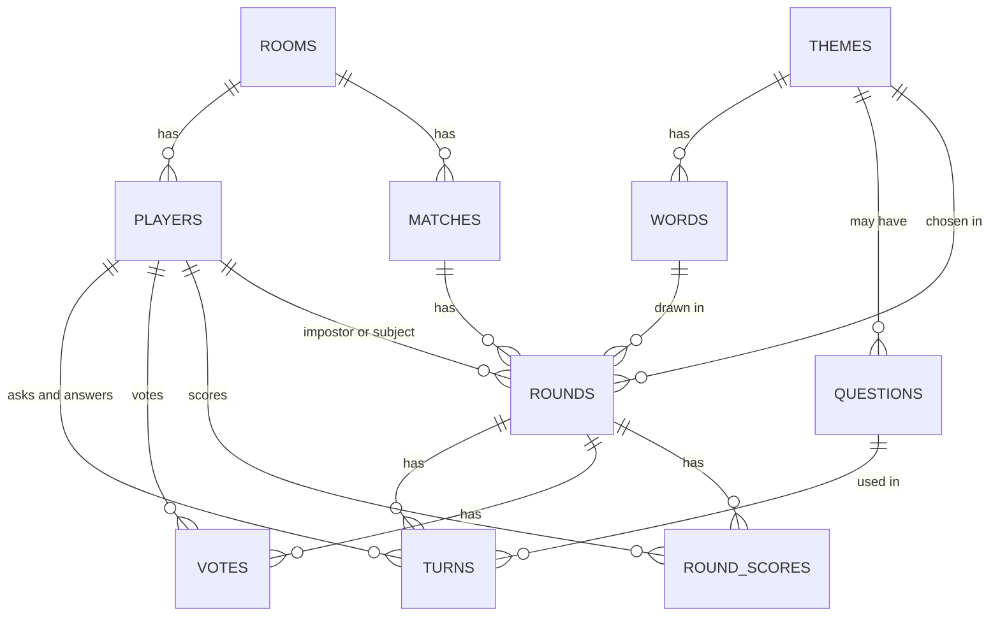

# Database

PostgreSQL 15 or newer (the `questions` table uses `UNIQUE NULLS NOT DISTINCT`). The schema is
created by the SQL migrations in `internal/storage/migrations`.

## Tables

| Table | Purpose |
|---|---|
| `themes` | Catalog of themes. `kind` is `words` or `players`. |
| `words` | Words of the `words` themes. |
| `questions` | Questions read aloud. `kind` is required, `theme_id` is optional (null means generic for that kind). |
| `rooms` | A room: `code`, `expires_at` (creation + 24h) and `empty_since`. |
| `players` | Players of a room: `is_host`, `token_hash` (SHA-256), `last_seen_at`. |
| `matches` | A match in a room: status, `total_rounds` (3, 5, 8, 10, 12), `turn_seconds`. "Play again" adds a match. |
| `rounds` | A round: phase, theme, secret (`word_id` or `subject_player_id`), impostor, `current_turn`, guess. |
| `turns` | The ring of turns of a round, created up front: asker, answerer, question, deadline, `ended_by`. |
| `votes` | One per player per round. `target_id` null is an abstention. |
| `round_scores` | Points per round and reason. The scoreboard is their sum. |

## Invariants enforced by the database

- `words` only belong to `words` themes (composite foreign key on `(theme_id, kind)`).
- A question's `kind` matches its theme's kind (composite foreign key; skipped for generic
  questions, whose `theme_id` is null).
- A question text is unique per `(kind, theme_id)`, including generic ones (`NULLS NOT DISTINCT`).
- At most one host per room (partial unique index) and unique player names within a room.
- A round never has both a word and a player as secret, and its word belongs to its theme.
- A question never repeats within a round, and a turn's asker differs from its answerer.
- Nobody votes for themselves.
- `matches.total_rounds`, phases, statuses and score reasons are limited by `CHECK` constraints.
- Deleting a room cascades to players, matches, rounds, turns, votes and scores.

## Conventions

- Primary keys: `uuid` generated by `gen_random_uuid()` for game state, `bigint` identity for the
  catalog.
- Timestamps are `timestamptz`.
- `text` plus `CHECK` instead of PostgreSQL enums, so adding a value is a simple migration.
- Positions and turn indexes are zero-based.

## Cleanup

`internal/janitor` calls `Rooms.DeleteExpired` every minute: rooms with `expires_at` in the past
and rooms empty for more than `EMPTY_ROOM_TTL` (1 hour) are deleted.
